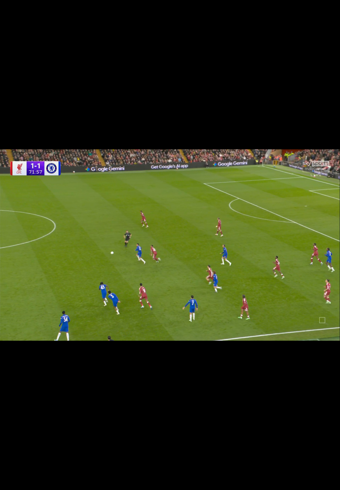

# Jet181 football playback recovery — 28 October 2026

Normal signed Release **2.0.1(181)** is installed on Jet iPad. The owner's current
repair/Jet gate supersedes the old build175 hold on this device. The phone, FPL
and multi-stream remain untouched. No TestFlight release.

## Actual normal-app acceptance

Home → Liverpool–Chelsea → Match details → Check streams returned seven options.
CS1 returned404 on two attempts; existing automatic recovery selected **CS2**,
listed Full HD, upstream PPV delivery, through the native guarded relay. The
normal Sources sheet identified CS2; opening/closing it preserved playback.

Actual decoded Sky Sports Liverpool–Chelsea programme showed1–1. Its match clock
advanced from64:50 through76:20 over more than ten minutes. EFL's independently
fetched current match metadata corroborated the exact Cup fixture, score and
SecondHalf at68′. Native fullscreen, native pause/resume and subsequent advancing
video pass. Landscape fullscreen was observed on the last passive check. The
stream was left playing. The screenshot below is the unedited native capture
from the earlier71:57 observation; no mock, injected URL or test launch is used.

Local redacted quality evidence records CS1's upstream404 stage, automatic
recovery to CS2 and successful decoded progress in2718ms. The same attempt owns
native fullscreen presentation. Raw attempt/session/device IDs, private settings,
media URLs and tokens are excluded. Volume appeared unmuted, but no person was
present to verify audible output. PiP was not retested in this focused gate.

## Source and backend repairs

- The common Streamed publisher is closed. Its three catalog mirrors are one
  publisher, not independent failovers. This repair does not restore that service.
- Owner-approved official EFL Carabao metadata is deployed via protected PR91,
  version2026-10-28.efl-cup-1. Cup identity is kept separate from Premier League;
  source-free verified fixtures can use existing Check streams discovery.
- CS added a literal same-origin `/api/manifest.m3u8` alias on26October. Fotty's
  admission/bindings recognized only `/api/manifest`. Both exact paths now use
  the existing safety checks; the headerless alias explicitly uses guarded relay.
  TLS/public-IP/redirect/header/nested-target restrictions remain. HTTP8008/2122
  and arbitrary route/host exceptions were not enabled.
- AS current dated metadata is resolved from the same advertised add-on ID;
  discovery no longer relies on the closed broadcast publisher for that date.
  Today's AS stream list was empty, so this is no AS playback qualification.
- Score808's calendar omits `visible` on valid rows. Its shipped calendar code
  defaults an absent field totrue; native decoding now agrees. Explicitfalse/null
  and other matching guards remain. Web playback was not qualified by this gate.

## Checks and preservation

Fresh focused compiled unit evidence:112 fixture/personalization/lookup cases
covered (111 initially passed; corrected newly invalid test data, then21 affected
cases passed on overlapping rerun); AS52passed/one intended physical skip;
CS/relay/Score808185passed/one intended physical skip. The current-source Mac
Catalyst unit harness is separate from this actual iPad manual playback evidence.
No skipped physical canary is counted as a playback pass. Signed Release compile
and deep strict signature validation pass.

The313-input manifest matches current disk:15 focused changes versus178,
298 unchanged. All42 protected FPL hashes and unchanged multi-stream inputs were
independently checked. All34 prelaunch plist slots matched across installation;
all25 nonvolatile configuration slots matched after playback. No source toggles,
FPL connection, interests, saved matches or sync settings were changed for testing.

Only the isolated8-path EFL backend patch was published. The separately approved
watchdog compatibility rebuild preserves activation, budgets and existing state;
its exact-revision observer passes. GitHub-only detection still has **no verified
owner chat/push bridge**. This remains an operational gap, not a resolved promise.

See verification.json, source-capture-metadata.json, app-inputs.sha256,
playback-evidence-redacted.json and official-programme-receipt.json. The source
capture is a private pre-build receipt, not a shared-release provenance gate.
Temporary signed apps, private preference copies, source bundle, logs and result
bundles are deleted after retaining these bounded receipts.

## Limits

This proves one current Cup CS2 delivery in the ordinary picker/player. It does
not qualify all32 admitted deliveries, all seven choices, future fixtures, AS,
cricket, Premier League or Champions League playback. CS1's404 is retained as a
failure; the generic startupTimeout summary is not a claim that the origin merely
responded slowly. Existing source qualification gates remain separate.
